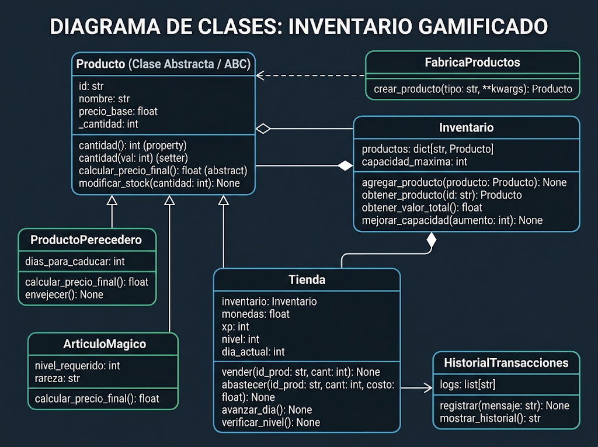

# 🏪 Proyecto Lúdico: Control de Inventarios Gamificado

Este proyecto consiste en el desarrollo de un sistema para el control de inventarios de una tienda, diseñado con un enfoque educativo y lúdico.

## 🎯 Objetivos del Proyecto

*   **Educativo:** Aplicar las mejores prácticas de desarrollo de software.
*   **Técnico:** Implementar principios de Programación Orientada a Objetos (POO) como encapsulamiento, polimorfismo y abstracción en Python.
*   **Diseño:** Crear un sistema modular y altamente reutilizable.
*   **Lúdico:** Incorporar mecánicas de gamificación (niveles, XP, misiones, días) para hacer del aprendizaje y la gestión una experiencia interactiva.

## 📂 Estructura del Proyecto



El código está organizado siguiendo el principio de Responsabilidad Única (SRP) y una arquitectura limpia orientada al dominio:

```text
inventario-py/
├── lai/
│   ├── dominio/            # (Models/Entities) El núcleo del negocio
│   │   ├── __init__.py
│   │   ├── producto.py     # Clase abstracta Producto y derivadas (Perecedero, Magico)
│   │   └── inventario.py   # Clase Inventario (Estructura de datos y gestión)
│   │
│   ├── fabricas/           # (Factories) Patrones de creación
│   │   ├── __init__.py
│   │   └── fabrica_productos.py # Clase FabricaProductos (Factory Method)
│   │
│   ├── motor/              # (Core/Controllers) Lógica del juego e interacciones
│   │   ├── __init__.py
│   │   └── tienda.py       # Clase Tienda (Gestor de monedas, XP y turnos)
│   │
│   ├── utilidades/         # (Utils) Servicios globales transversales
│   │   ├── __init__.py
│   │   └── historial.py    # Clase HistorialTransacciones (Singleton)
│   │
│   └── tests/              # Pruebas unitarias (TDD)
│       ├── __init__.py
│       └── test_productos.py
│
└── main.py                 # Punto de entrada de la aplicación interactiva
